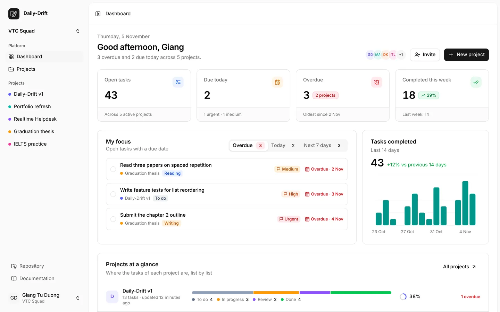
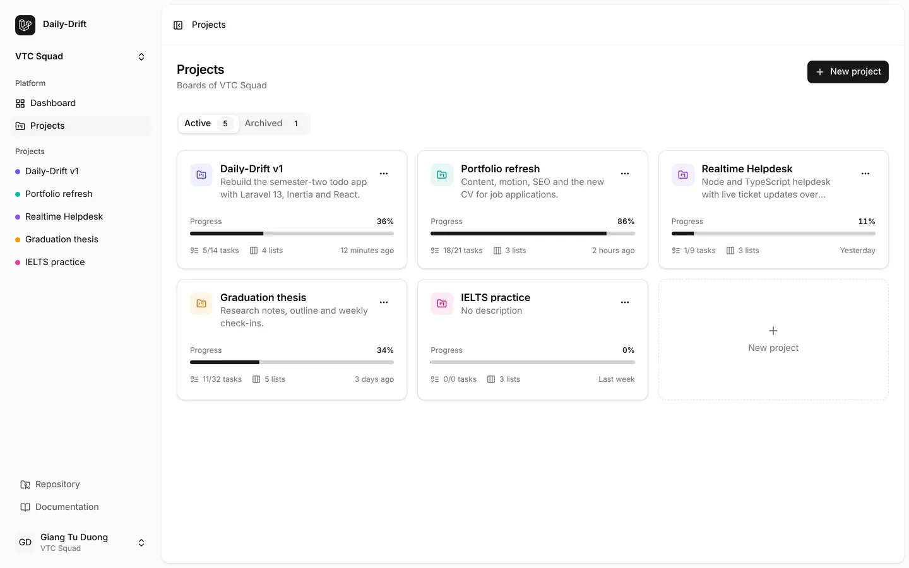
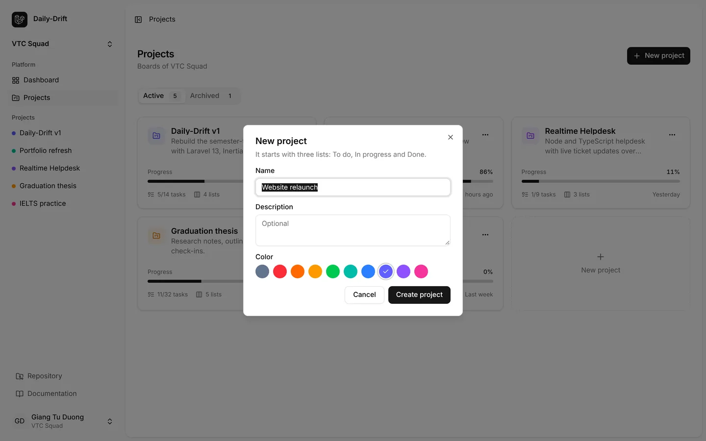
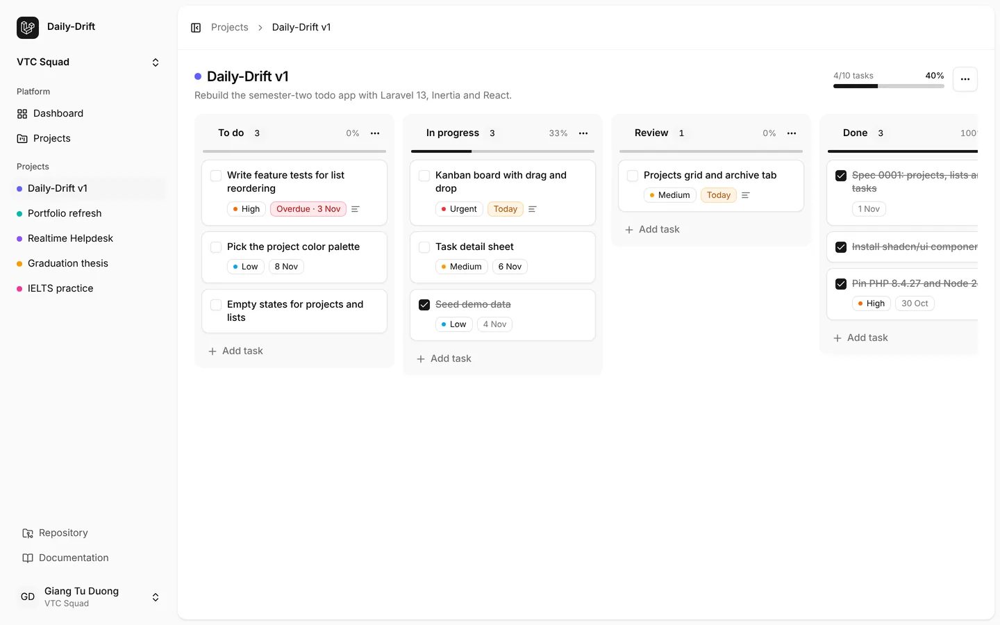
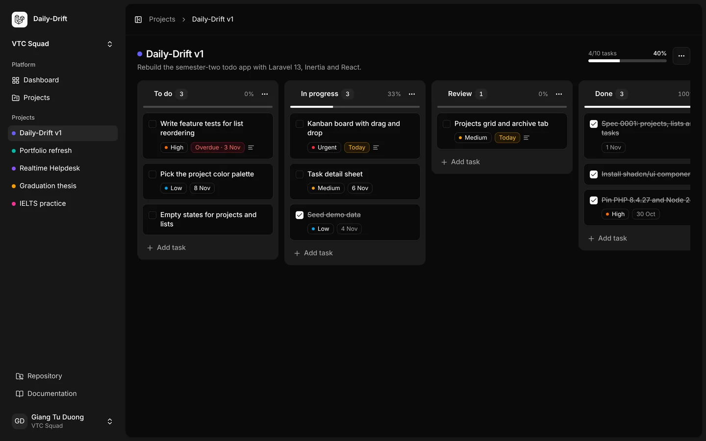
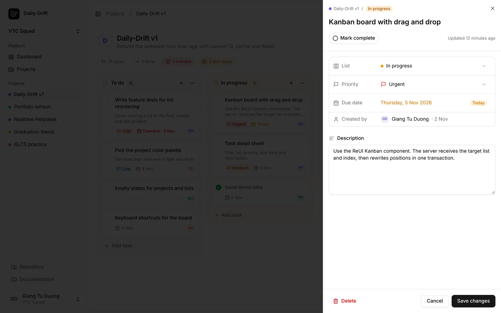
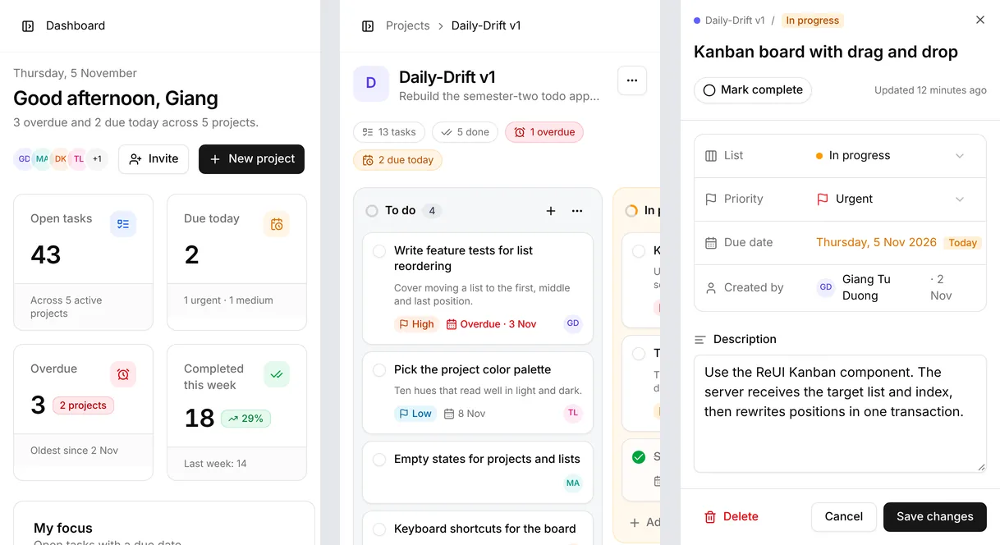

# Design

**Status:** Phase 1 designed (second version). The screenshots come from a prototype built with the installed components and sample data, in the app's own theme.

## Principles

- Keep the starter kit's shell (inset sidebar that collapses to icons, team switcher, breadcrumbs, light and dark themes) and put the effort into the pages.
- Color carries meaning, not decoration: every project and every list has a hue from one palette, and that hue tints its tile, column, pills and progress.
- A card or row answers "what, where, how urgent, who" at a glance: title, project or list, priority, due date and the person behind it.
- Color is never the only signal: priorities, due states and lists always carry a text label.
- Every action works with the keyboard, including drag and drop.
- Phones get the same features: stat cards fall into two columns, boards scroll sideways one column at a time, and the task sheet fills the screen.

## App shell

- **Sidebar:** _Dashboard_ and _Projects_, then a _Projects_ group with the five most recently updated active projects, each with its color dot.
- **Header:** breadcrumbs, for example _Projects › Daily-Drift v1_.
- The Laravel logo from the kit is still in place; a Daily-Drift mark replaces it later in Phase 1.

## Screens for Phase 1

### Dashboard

- **Greeting header:** date, "Good afternoon, {first name}", a one-line summary ("3 overdue and 2 due today across 5 projects"), team member avatars, _Invite_ (opens the kit's invite dialog) and _New project_.
- **Stat cards:** open tasks, due today, overdue, completed this week. Each card has a colored icon tile, a badge where a comparison helps (overdue spread over projects, change against last week), and a footer line with context.
- **My focus:** open tasks with a due date, in tabs _Overdue_, _Today_ and _Next 7 days_ with counts. Each row: round checkbox, title, project dot and name, list pill in the list's color, priority and due date.
- **Tasks completed:** total for the last 14 days, change against the 14 days before, and a bar per day.
- **Projects at a glance:** one row per active project with its tile, a segmented bar of tasks per list in the list colors (with a legend and counts), a progress ring and either the overdue count or the next due date.

### Projects

- Header with the count of active boards and _New project_; tabs _Active_ and _Archived_ with counts; a name filter.
- **Project card:** a soft gradient in the project's hue, a letter tile, name and last update, a menu (_Edit_, _Archive_ or _Restore_, _Delete_), a two-line description, three small stats (open, due in the next 7 days, overdue in red when not zero), progress in the project's hue, and a footer with the people who created its tasks and the next due date.
- A dashed _New project_ card closes the grid.
- Members see no create, edit, archive or delete controls; admins see no _Delete_ (see the permissions in [spec 0001](../spec/0001-projects-lists-tasks.md#permissions)).

- The dialog header takes the chosen color, so the tile previews the project. Fields: name, optional description, ten color swatches; the default lists are shown as pills in their colors.
- _Edit_ reuses the same dialog.

### Project board

- **Header:** tile, name and description; team avatars, _New task_ (adds to the first list) and a project menu (_Edit project_, _Add list_, _Archive_, _Delete project_).
- **Summary chips:** total tasks, done, overdue (red), due today (amber), and overall progress in the project's hue.
- **Columns** are tinted with the list's hue. The header shows a progress ring (share of completed tasks in that list), the name and a count pill; it is also the drag handle for reordering lists. Buttons add a task or open the list menu (_Rename_, _Change color_, _Delete list_).
- **Task cards:** round checkbox (green when complete), title, two-line description, priority pill with a flag, due date (red _Overdue · 3 Nov_, amber _Today_, plain date otherwise) and the creator's avatar. Completed cards drop the description and priority and strike the title.
- _Add task_ at the bottom of each column opens an inline title field (Enter adds, Escape cancels). A dashed _Add list_ sits after the last column.
- Dragging shows the card under the pointer and a gap where it will land. When it is dropped, the client sends the target list and index, and the server rewrites positions in one transaction (spec 0001). If the request fails, the board rolls back and shows a toast.
- Archived projects show a read-only banner with _Restore_, and dragging is disabled.

### Task detail

- A sheet from the right, opened by clicking a card. The URL gets `?task={id}`, so the dashboard can link straight to a task.
- Header: project and list pill, editable title, _Mark complete_ as a round toggle, last update.
- Properties in one bordered panel, each row with an icon: list (moving it here puts the task at the end of that list), priority (flag in its color), due date (calendar popover, with a _Today_ marker), created by.
- Plain-text description, then _Delete_ (with confirmation), _Cancel_ and _Save changes_.

### Phones

- Board columns snap while scrolling sideways. A drag starts after a 250 ms touch hold, so scrolling still works.

## Tokens

| Token     | Values                                                                                                         |
| --------- | -------------------------------------------------------------------------------------------------------------- |
| Hue       | `slate`, `red`, `orange`, `amber`, `green`, `teal`, `blue`, `indigo`, `violet`, `pink`; for projects and lists |
| Priority  | `none` (no pill), `low` sky, `medium` amber, `high` orange, `urgent` red; a flag icon and a label              |
| Due state | overdue: red with "Overdue"; today: amber "Today"; later: neutral date; completed: muted                       |

Each hue maps to a fixed set of Tailwind classes (dot, tile, column tint, pill, bar, ring stroke). The names are what `projects.color` and `task_lists.color` store.

## Components by screen

| Screen       | shadcn/ui components                                                        | Blocks and patterns                                                                                       |
| ------------ | --------------------------------------------------------------------------- | --------------------------------------------------------------------------------------------------------- |
| App shell    | `sidebar`, `breadcrumb`                                                     | From the starter kit                                                                                      |
| Dashboard    | `card`, `badge`, `tabs`, `checkbox`, `chart`, `avatar`, `tooltip`, `button` | ShadcnUIKit _Stat Card 1_ and _Todo App 1_ (adapted); segmented bar after ShadcnUIKit _Stat Card 2_       |
| Projects     | `tabs`, `badge`, `input`, `dropdown-menu`, `dialog`, `avatar`, `tooltip`    | Card layout after shadcn/studio _Widget 24_; delete confirmation from shadcn/studio `dashboard-dialog-22` |
| Board        | `button`, `checkbox`, `dropdown-menu`, `input`, `avatar`, `tooltip`         | ReUI `kanban`; colored columns after Shadcn Space and shadcn/studio kanban boards                         |
| Task detail  | `sheet`, `select`, `popover`, `calendar`, `textarea`                        | Card layout after ShadcnUIKit _Kanban Board 2_ (task fields)                                              |
| Empty states | `empty`                                                                     | Adapted from ReUI `c-empty-12`                                                                            |
| Feedback     | `sonner`                                                                    | None                                                                                                      |

The progress ring, segmented bar and hue bar are small local components built for this design.

## Sources

Code is taken only from free items, in their Radix versions. Paid blocks were looked at for layout ideas only; none of their code is used.

| Source                                    | License of free items                                                  | Code used                                                                                                                                                                     | Ideas from paid previews                                                               |
| ----------------------------------------- | ---------------------------------------------------------------------- | ----------------------------------------------------------------------------------------------------------------------------------------------------------------------------- | -------------------------------------------------------------------------------------- |
| [shadcn/ui](https://ui.shadcn.com)        | MIT                                                                    | All components above, including `chart`.                                                                                                                                      | None                                                                                   |
| [ReUI](https://reui.io)                   | MIT                                                                    | `kanban` component, installed as is ([ADR 0005](../decisions/0005-reui-kanban-for-drag-and-drop.md)); `c-kanban-6` (save on drop with rollback) and `c-empty-12` as patterns. | None                                                                                   |
| [ShadcnUIKit](https://shadcnuikit.com)    | Free items: personal and commercial use; no redistribution as a UI kit | `stat-card1` (stat card with footer), `todo-app1` (task rows), both adapted.                                                                                                  | _Kanban Board 2_ (task card fields), _Stat Card 2_ (segmented pipeline bar)            |
| [shadcn/studio](https://shadcnstudio.com) | MIT with Commons Clause: no resale or redistribution unmodified        | `dashboard-dialog-22` (destructive confirmation), adapted.                                                                                                                    | _Widget 24_ (project card with stats and members), _Kanban App 04/05_ (tinted columns) |
| [Shadcn Space](https://shadcnspace.com)   | Free license; do not present the components as your own                | `kanban-application-01`: status icons in column headers and the inline _Add task_ form, as patterns.                                                                          | `kanban-application-02` (color-coded columns)                                          |

## Installing from these registries

The shadcn CLI knows all of these registries, but this project's `new-york` style does not resolve correctly for two of them:

- **ReUI:** `@reui/<name>` with `new-york` returns the Base UI version. Install from `https://reui.io/r/styles/radix-vega/<name>.json` instead (`radix-vega` is the Radix version of the classic shadcn look). The CLI writes the file to `components/reui/` at the repository root; move it to `resources/js/components/reui/`.
- **shadcn/studio:** rejects `new-york`; use `https://shadcnstudio.com/r/new-york-v4/<name>.json`.
- **ShadcnUIKit** and **Shadcn Space** serve free items at `https://shadcnuikit.com/r/<name>.json` and `https://shadcnspace.com/r/<name>.json`; paid ones answer with an authentication error.

The first pull request that installs from these registries adds the ReUI and shadcn/studio URLs to `registries` in `components.json`, so `@reui/...` and `@shadcn-studio/...` resolve to the right versions (checked with `shadcn view`).
